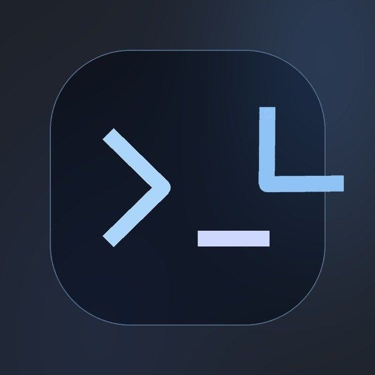
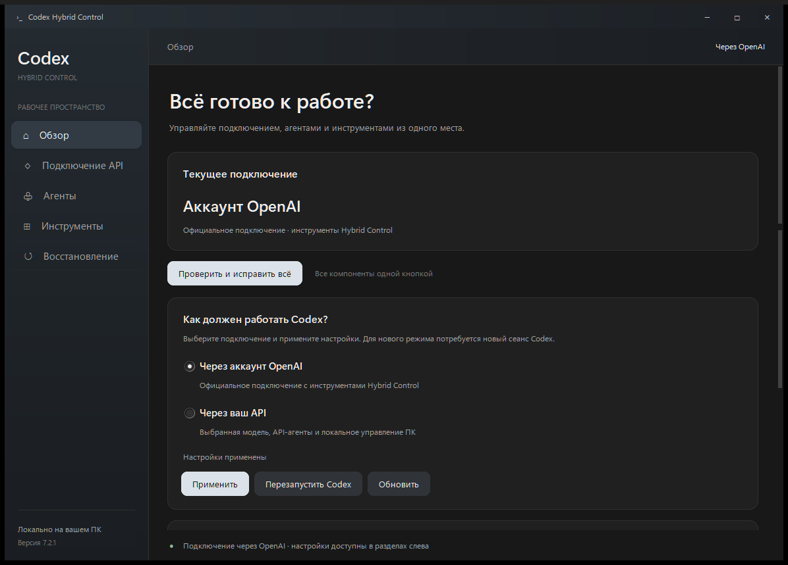
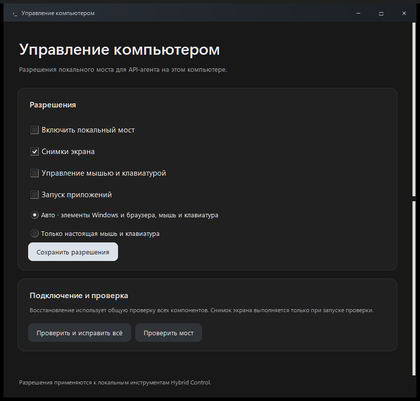

<div align="center">
  <p><a href="#русский">Русский</a> · <a href="#english">English</a></p>
  
  <h1>Codex Hybrid Control</h1>
  <p><b>Твой API. Настоящий Codex. Одна удобная панель.</b></p>
  <p>Подключения · агенты · управление Windows и браузером · восстановление</p>
  <a href="https://github.com/talatick964/codex-hybrid-control/releases/latest/download/Codex-Hybrid-Control-7.3.2-Windows.zip"></a>
  <a href="https://t.me/aislopprogs"></a>
  <p><a href="docs/INSTALL.md">Как установить</a> · <a href="https://github.com/talatick964/codex-hybrid-control/issues/new/choose">Сообщить об ошибке</a> · <a href="https://github.com/talatick964/codex-hybrid-control/releases">Все версии</a></p>
</div>

---

<a id="русский"></a>

Панель настраивает **установленный Codex** для работы через твой API. Здесь можно менять провайдера и модель, подключать агентов и локальные инструменты, проверять ошибки и возвращаться к обычному Codex.

### Запуск за несколько минут

Нужны **Windows, установленный Codex с CLI и свой API-ключ**. Провайдер должен поддерживать Responses API. Python для готовой программы не нужен.

1. [Скачай ZIP](https://github.com/talatick964/codex-hybrid-control/releases/latest/download/Codex-Hybrid-Control-7.3.2-Windows.zip), распакуй и запусти **Codex-Hybrid-Control.exe**.
2. В **«Подключение API»** добавь ключ и выбери модель.
3. Посмотри изменения, нажми **«Применить»**, затем **«Проверить и исправить всё»**.
4. В Codex CLI открой `/hooks`: подтверди обработчик Hybrid Control, если он ещё не доверенный. Перезапусти Codex и создай новый сеанс.

### Что внутри

| Возможность | Для чего |
| --- | --- |
| Профили подключения | Быстро менять API и модель |
| Предпросмотр и откат | Видеть изменения и возвращать настройки |
| Компьютер и браузер | Работать с элементами окон, страницами и настоящими кликами |
| Контроль API | Ограничивать ожидание, замечать повторы и преждевременную остановку |
| Общий ремонт | Проверять и восстанавливать компоненты одной кнопкой |
| Обычный Codex | Обратимо отключать Hybrid Control |

<details>
<summary><b>Посмотреть интерфейс</b></summary>
<br>

<br><br>

</details>

Проверено: **199 тестов**, готовые EXE, управление Windows и отдельной сессией Edge. [Отчёт](docs/VERIFY.md) · [Что нового](CHANGELOG.md) · [Исходники и сборка](docs/INSTALL.md#из-исходников).

Контроль API помогает восстановиться после сбоев, но не гарантирует исправность любого провайдера. [Возможности и ограничения](docs/FEATURES.md).

ZIP с готовой программой можно скачать и **[прямо в Telegram](https://t.me/aislopprogs/10)**, если так удобнее.

Новости, идеи и обратная связь — **[АИслоп в Telegram](https://t.me/aislopprogs)**. В сообщениях об ошибках не публикуй API-ключи и личные логи.

<sub>Независимый проект, не связан с OpenAI. [Сторонние компоненты](THIRD_PARTY_NOTICES.md).</sub>

---

<a id="english"></a>

## English

**Your API. The real Codex. One convenient control panel.**

Codex Hybrid Control configures your installed Codex to use your own API provider. Switch providers and models, connect external agents and local tools, diagnose problems, or restore standard Codex settings. The Windows app currently has a Russian interface.

**[Download for Windows](https://github.com/talatick964/codex-hybrid-control/releases/latest/download/Codex-Hybrid-Control-7.3.2-Windows.zip) · [Download from Telegram](https://t.me/aislopprogs/10) · [Report a bug](https://github.com/talatick964/codex-hybrid-control/issues/new/choose)**

### Quick start

You need **Windows, Codex with its CLI, and your own API key**. Your provider must support the Responses API. The packaged app does not require Python.

1. Download and extract the ZIP. Run **Codex-Hybrid-Control.exe**.
2. Open **«Подключение API»** (API connection), enter your key and select a model.
3. Preview the changes, click **«Применить»** (Apply), then **«Проверить и исправить всё»** (Check and repair everything).
4. In Codex CLI, open `/hooks` and trust the Hybrid Control handler if needed. Restart Codex and create a new session.

### Features

| Feature | What it does |
| --- | --- |
| Connection profiles | Switch API providers and models |
| Preview and rollback | Review changes and restore settings |
| Computer and browser tools | Access Windows elements, browser pages and real mouse clicks |
| API safeguards | Limit waiting, detect repeated actions and suspicious early completion |
| One-click repair | Check and restore the components |
| Standard Codex mode | Reversibly disable Hybrid Control |

**199 tests passed locally**, including packaged EXEs, Windows controls and a separate Edge session. API safeguards cannot guarantee that every provider or model will work correctly.

### Build from source

Windows and Python 3.10+:

```powershell
python -m venv .venv
.venv/Scripts/python.exe -m pip install -r requirements.txt
.venv/Scripts/python.exe control_entry.py
```

For tests, install `requirements-dev.txt` and run `python -m pytest tests -q`. EXE build commands are in [the installation guide](docs/INSTALL.md#english).

Releases are also available in **[Telegram](https://t.me/aislopprogs/10)** if you prefer downloading there. The channel is in Russian. For feedback in English, use [GitHub Issues](https://github.com/talatick964/codex-hybrid-control/issues/new/choose) or [Discussions](https://github.com/talatick964/codex-hybrid-control/discussions). Never share API keys or private logs.

<sub>Independent project, not affiliated with OpenAI. [Third-party notices](THIRD_PARTY_NOTICES.md).</sub>
