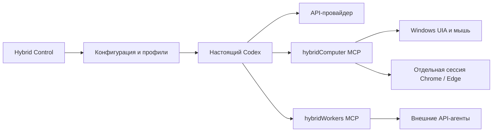

# Устройство проекта

| Файлы | Ответственность |
| --- | --- |
| `control_entry.py`, `hybrid_ui.py`, `hybrid_widgets.py` | Запуск и интерфейс панели |
| `codex_hybrid_control.py` | Конфигурация Codex, профили и базовые инструменты |
| `hybrid_connections.py`, `hybrid_recovery.py` | Подключения, предпросмотр и откат |
| `hybrid_diagnostics.py`, `hybrid_catalog.py` | Диагностика API и совместимость каталога |
| `hybrid_bridge_host.py`, `hybrid_process.py` | Дочерние мосты и ограничение ожидания |
| `hybrid_accessibility.py`, `hybrid_browser_control.py` | UIA и браузерный протокол |
| `hybrid_actions.py`, `hybrid_storage.py` | Журнал действий и блокировки состояния |
| `hybrid_chat.py`, `hybrid_resilience.py` | Дополнительный чат и восстановление ответов |
| `tests/` | Автоматические проверки |

Мосты используют stdio MCP. Локальное браузерное управление открывает loopback DevTools endpoint для отдельной сессии. Персональные настройки и ключи не являются частью исходного репозитория.
